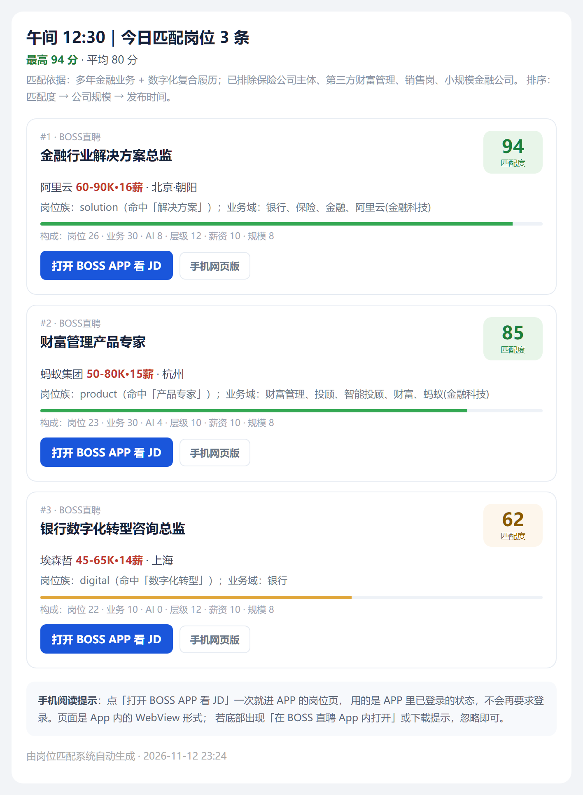
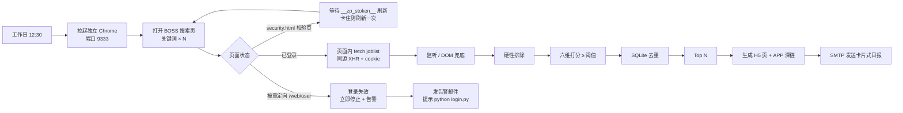

# 岗位雷达 · Job Match Radar

[](https://www.python.org/)
[](#快速开始)
[](LICENSE)

每个**工作日 12:30** 定时从 **BOSS 直聘** 采集岗位，按你的简历画像做**硬性排除 + 六维打分**，SQLite 去重后把**当天新增**的 Top N 岗位渲染成卡片式 HTML 日报，通过 SMTP 发到邮箱。邮件里直接显示 **0–100 匹配度评分**，并提供「打开 APP 看 JD」与手机网页兜底。

> **只做筛选，不做投递。** 脚本只读取搜索列表和岗位字段，不会点「立即沟通」「投递简历」，也不会自动联系招聘方。最终投不投、投哪家，由你自己决定。

> 面向「金融业务 + 数字化」这类复合背景的求职场景：先把不想要的岗位挡掉（保险公司主体、第三方财富、纯销售岗、小金融机构），再在剩下的岗位里按业务域相关度排序，避免「大厂通用岗」挤掉「真正对口岗」。

<p align="center">
  
  <br>
  <sub>示例日报（demo 数据）：匹配度、六维构成与 APP 直达入口</sub>
</p>

## 目录

- [特性](#特性)
- [工作流](#工作流)
- [快速开始](#快速开始)
  - [1. 安装](#1-安装)
  - [2. 首次登录](#2-首次登录)
  - [3. 配置邮箱](#3-配置邮箱)
  - [4. 试跑](#4-试跑)
  - [5. 定时运行](#5-定时运行)
- [双画像：一份代码，多份简历](#双画像一份代码多份简历)
- [配置说明](#配置说明)
- [打分机制](#打分机制)
- [邮件与 APP 深链](#邮件与-app-深链)
- [目录结构](#目录结构)
- [环境变量](#环境变量)
- [常见问题与排查](#常见问题与排查)
- [隐私与安全](#隐私与安全)
- [免责声明](#免责声明)
- [License](#license)

## 特性

- **只采 BOSS 直聘**：搜索、登录态、风控处理全部围绕 BOSS 一条链路，不再混入其他招聘站。
- **像真人一样取数**：打开真实搜索页，先让页面正常渲染；再在页面上下文里 `fetch` 同源 `joblist.json`（带 cookie / referer），拿明文薪资与完整字段。接口被挡时读已渲染的 DOM（薪资图标字体自动解码），再不行才收页面自己的响应。**不会**再把接口当页面直接打开。
- **登录态先探测、失效即停**：搜索页被重定向到 `/web/user/` 就立即停止，不再拿多个关键词硬试，也不在掉登录后继续打接口。
- **认出「37 不是封禁」**：BOSS 会定期刷新 `__zp_stoken__`，搜索页会先跳到 `/web/passport/zp/security.html?code=37`，或先回到首页做 `_security_check`，由页面脚本算出新 token 再继续。脚本会等它完成（必要时刷新一次），然后重新打开搜索页；只有校验页始终不完成才停止。旧代码把这一步当成封禁，所以每次 token 过期都空手而归。
- **风控分级处理**：`code=35/36` 才是 IP / 账号级风控，`code=37` 多数是上面的 token 刷新。单个关键词退避 12–22 秒重试一次；连续 3 个关键词都被挡才熔断，避免一个瞬时错误把整轮结果清零。
- **登录态更耐久**：每轮结束正常关闭 Chrome（`Browser.close`），让 cookie 落盘；不再强制 `Stop-Process` 杀进程。
- **硬性排除**：销售岗、保险公司主体（科技子公司放行）、第三方财富/投资咨询、传统金融机构主体、薪资不达标。
- **六维打分**：岗位族 26 + 业务域 30 + AI/科技 14 + 层级 12 + 薪资 10 + 公司规模 8，阈值 50 分才推送。
- **评分直接进邮件**：每条岗位显示匹配度分数、分数档位配色、六维构成；邮件标题带最高分。
- **手机端直达 JD**：按钮是 BOSS 官方 `bosszp://` 深链，iPhone 自带「邮件」/ Gmail 一次点击进 APP 岗位页，复用 APP 登录态；QQ 邮箱另给一条 https 跳转页兜底。
- **跨次去重**：SQLite 记录已推送岗位，同一岗位 30 天内不重复出现；每次只发**新岗位**，当天没有新增就不发信（只在日志里记 `SKIP:no-new`）。
- **卡片式日报**：按手机阅读优化，一屏一条岗位；采集到 0 条时改发「需要人工补登」告警，并说明是掉登录、卡验证还是风控。
- **可编排**：内置 `install_task.ps1` 一键注册 Windows 计划任务（工作日推送 + 看门狗）。
- **无凭据入库**：授权码只从 `.env` 读取，`.env`、登录态、简历、数据库均在 `.gitignore` 中。

## 工作流



## 快速开始

要求：Windows、Python 3.10+、本机已安装 Chrome。

### 1. 安装

```powershell
git clone https://github.com/jesse0713/job-match-radar.git
cd job-match-radar
python -m venv .venv
.\.venv\Scripts\Activate.ps1
pip install -r requirements.txt
copy .env.example .env
```

> **常见报错**：如果手动运行报 `ModuleNotFoundError: No module named 'DrissionPage'`，说明当前 `python` 不是装依赖的那个解释器。两种解决：
> 1. 给当前解释器装依赖：`python -m pip install -r requirements.txt`
> 2. 直接指定项目使用的解释器：`C:\Path\To\Python\python.exe login.py`
>
> **不要把依赖装进会被自动升级重建的运行时**（例如某些桌面端自带的 Python）。这类目录升级时会按固定清单重建，`pip install` 进去的包会被静默清掉，表现就是计划任务每天准点触发、却没有日志也没有邮件。`install_task.ps1` 会逐个探测解释器，只把任务注册到「真的能 `import DrissionPage`」的那个上。

### 2. 首次登录

程序通过 CDP 附着到一个**独立配置**的 Chrome（默认端口 9333），不会干扰日常浏览器：

```powershell
python login.py
```

弹出的浏览器窗口里用 **BOSS APP 扫码**。脚本会一直盯着搜索页，检测到能正常出岗位就自动保存登录态并关闭窗口。登录态保存在 `chrome-profile/`，后续自动复用。该目录等同账号凭据，**不要提交、不要外发**。

> 之后登录掉了（邮件里出现「登录态已失效」）也是跑同一条命令：`python login.py` 直接扫码；`python login.py --check` 只体检不扫码。
>
> `--check` 只打开搜索页看状态：正常出岗位 / 被重定向到登录页 / 卡在安全验证 / 正在刷新 `__zp_stoken__`。它不会在掉登录后请求 `wapi` 接口，所以不会加重风控。退出码：`0` 正常、`2` 需要扫码、`3` 正在环境校验（等 1–2 分钟再查）。

### 3. 配置邮箱

在 `.env` 中填入邮箱 SMTP 授权码（QQ 邮箱：设置 → 账户 → 开启 SMTP → 生成授权码）：

```ini
QQ_SMTP_AUTH=你的授权码
MAIL_FROM=you@qq.com
MAIL_TO=you@qq.com
```

### 4. 试跑

```powershell
python run_daily.py --demo --dry-run          # 假数据验证打分与渲染链路
python run_daily.py --slot 12:30 --dry-run    # 真实采集，只写 .eml 预览不发信
python run_daily.py --slot 12:30              # 真实采集并发送
python run_daily.py --demo --dry-run --profile legal   # 法务画像示例
python -m unittest test_links -v              # 链接 + 解析 + 渲染 + 画像合并回归
```

`outbox/` 下会生成 `.eml` 和 `preview.html`，可直接用邮件客户端打开检查版式。

### 5. 定时运行

```powershell
powershell -ExecutionPolicy Bypass -File .\install_task.ps1
```

脚本会读取 `config.json` 的 `search.run_times` 注册计划任务（默认 `JobMatch-1230`，**周一至周五** 12:30），并自动探测 Python：

- 先看 `-Python` 参数，再找 PATH 里的 `pythonw.exe` / `python.exe`，最后扫描 `%LOCALAPPDATA%\Programs\Python`；
- 逐个执行 `import DrissionPage` 探测，只注册到通过探测的解释器；
- 同时注册 `JobMatch-Watchdog`（工作日 13:30）：当天没有任何一条成功记录（`SENT` 或 `SKIP`）时发告警邮件。

如果 `profiles/legal/config.json` 存在，还会顺带注册 `JobMatch-Legal-1245`（12:45）和 `JobMatch-Legal-Watchdog`（13:45）——两个画像共用 9333 端口的 Chrome，时间必须错开。

删除：`Unregister-ScheduledTask -TaskName "JobMatch-1230" -Confirm:$false`（`JobMatch-Legal-1245`、`JobMatch-Watchdog` 同理）。

自检：`schtasks /query /tn "JobMatch-1230" /fo LIST /v`，重点看 `Task To Run` 和 `Last Result`（0 = 正常）。

> `WakeToRun` 已开启：电脑处于睡眠时，任务会唤醒机器执行，保证工作日准点。
> 同时关闭了「仅电池时不启动」「切换到电池时停止」，避免笔记本拔电导致漏跑。
> 已关机（非睡眠）时无法唤醒，由 `StartWhenAvailable` 在下次开机后补跑，且与去重库共用，不会重复推送。
>
> **路径注意**：项目目录含中文时，PowerShell 5.1 会把无 BOM 脚本按 GBK 解码，可能让注册进计划任务的路径变成乱码（`0x8007000B`）。`install_task.ps1` 已写成纯 ASCII，并用 `$PSScriptRoot` 取项目目录。若仍遇到编码问题，可建一个 ASCII junction 再装：
>
> ```powershell
> cmd /c mklink /J "%USERPROFILE%\JobMatch" "<项目目录>"
> powershell -ExecutionPolicy Bypass -File .\install_task.ps1 -Root "%USERPROFILE%\JobMatch"
> ```

## 双画像：一份代码，多份简历

同一套代码可以跑多份求职画像。基础 `config.json` 是「金融业务 + 数字化」方向；`profiles/<name>/config.json` 只写要覆盖的键，其余（公司规模提示、金融科技白名单等）递归沿用基础配置，避免两份配置各自漂移。

仓库内置两个画像作为示例：

| 画像 | 目录 | 方向 | 推送时间 |
|---|---|---|---|
| （默认） | `config.json` | 金融解决方案 / FDE / 数字化 | 工作日 12:30 |
| `legal` | `profiles/legal/config.json` | 法务总监 / 合规总监 | 工作日 12:45 |

```powershell
python run_daily.py --demo --dry-run --profile legal   # 验证法务画像打分链路
python run_daily.py --slot 12:45 --profile legal       # 真实采集并发送
python watchdog.py --profile legal                     # 法务画像的看门狗
```

画像之间完全隔离，互不污染：

| 产物 | 默认画像 | legal 画像 |
|---|---|---|
| 去重库 | `jobs.db` | `jobs-legal.db` |
| 日志 | `logs/daily.log` | `logs/legal/daily.log` |
| 邮件预览 | `outbox/` | `outbox/legal/` |
| 收件人 | `.env` 的 `MAIL_TO` | `.env` 的 `MAIL_TO_LEGAL`（`mail.env_to_key`） |

`legal` 画像和基础画像的差异不止关键词：

- **放开金融机构主体**：`exclude_finance_entity=false`、`exclude_insurance_entity=false`——目标就是银行 / 保险 / 消金 / 支付，基础画像那条「传统金融机构一律排除」会全灭；
- **反向排除律所**：`company_block=[律师事务所]`，只要甲方 in-house；
- **挡降级岗**：`title_block` 挡掉实习律师 / 律师助理 / 法务专员 / 合规专员；
- **城市白名单**：BOSS 搜索是全国口径，`search.city_allow` 只保留目标城市；
- **薪资下限按城市调整**：示例设 25K，一线城市可上调到 35K–40K；
- **权重重排**：业务域 34、岗位族 26、层级 14、薪资 12、规模 8、AI 只留 6——法务岗的 AI 属性是加分项，不该和业务域同权。

> 两个画像共用同一个 Chrome（端口 9333），所以时间必须错开；`install_task.ps1` 会分别注册 `JobMatch-1230` 与 `JobMatch-Legal-1245`（各带一个看门狗）。
>
> 新增画像：复制 `profiles/legal/config.json` 为 `profiles/<name>/config.json`，改关键词、城市、排除规则和权重即可，无需改代码。

## 配置说明

调策略只改 `config.json`，不用动代码。画像改 `profiles/<name>/config.json`。

| 键 | 说明 |
|---|---|
| `mail.*` | SMTP 服务器与收发件地址；真实地址建议放在 `.env` 的 `MAIL_FROM` / `MAIL_TO` |
| `mail.smartlink_base` | https 跳转页地址；BOSS 邮件按钮优先走官方 H5 页，此项只作兜底 |
| `search.daily_count` | 每次最多推送条数（默认 10） |
| `search.min_salary_k` | 月薪下限（K），薪资上限低于该值直接排除 |
| `search.run_times` | 计划任务的运行时刻（默认只有 `12:30`） |
| `search.weekdays_only` | 只在周一至周五推送（默认 `true`）；周末即使被补跑也会跳过 |
| `search.skip_when_no_new` | 当天没有新岗位时不发信，只记 `SKIP:no-new`（默认 `true`）；设 `false` 则每天必发一封 |
| `search.watchdog_time` | 看门狗运行时刻（默认 `13:30`，同样是工作日） |
| `search.max_pages` | 每个关键词翻几页（默认 1，翻页越多越容易触发风控） |
| `search.keyword_delay_seconds` | 关键词之间的随机停顿区间（秒） |
| `search.block_retries` | 单个关键词被风控后重试几次（默认 1） |
| `search.city_allow` | 城市白名单，如 `["北京","上海"]`；不配则保持 BOSS 的全国口径 |
| `keywords.core` / `.extra` | 搜索关键词；`extra` 每天轮换一个，扩大覆盖面 |
| `candidate_profile.summary` | 邮件里「匹配依据」的一句话说明 |
| `candidate_profile.excluded_note` | 邮件里「已排除……」那句话，各画像可不同 |
| `role_families` | 岗位族与权重（解决方案 / FDE / 产品 / 数字化 / 交付） |
| `domain_terms` | 业务域词表，分高/中/低三档给分 |
| `ai_tech_terms` | AI / 科技属性词表 |
| `seniority` | 职级词表（总监 / 专家 / 经理 / 初级） |
| `exclude.*` | 排除规则：销售岗、财富管理主体、保险主体、科技子公司白名单、规模门槛 |
| `exclude.exclude_finance_entity` | 是否排除传统金融机构主体；法务画像设 `false` |
| `exclude.exclude_insurance_entity` | 是否排除保险公司主体；法务画像设 `false` |
| `exclude.title_block` | 岗位名黑名单，如实习律师 / 法务专员（挡降级岗） |
| `exclude.company_block` | 公司名黑名单，如律师事务所（只要甲方） |
| `company_scale_hint` | 常见公司规模提示，用于补全接口未返回的规模字段 |
| `scoring.*` | 六维满分、推送阈值与 `domain_floor`（业务域降权门槛） |

## 打分机制

硬性排除命中即 0 分，不进入排序：

1. 城市不在 `search.city_allow` 白名单（配了才生效）
2. 岗位名命中 `exclude.title_block`（降级岗，如法务专员 / 实习律师）
3. 岗位名含销售类关键词（售前 / 解决方案 / 架构 / 产品 / 咨询 例外）
4. 公司为保险公司主体且不含科技子公司特征（`exclude_insurance_entity=false` 时跳过）
5. 公司为第三方财富管理 / 投资咨询
6. 公司为传统金融机构主体（`exclude_finance_entity=false` 时跳过）
7. 公司名命中 `exclude.company_block`（如律师事务所）
8. 薪资上限低于 `min_salary_k`

通过后按六维累加：

| 维度 | 满分 | 逻辑 |
|---|---|---|
| 业务域 | 30 | 高权重词 +6、中 +4、低 +2；标题命中高权重词再 +4 |
| 岗位族 | 26 | 5 个岗位族按权重取最高命中 |
| AI / 科技 | 14 | 命中词数 × 4，封顶 14 |
| 层级 | 12 | 总监级 12、专家级 10、默认 6、初级 1 |
| 薪资 | 10 | 达下限满分；未标注 5 分；明显偏低降权 |
| 公司规模 | 8 | 规模档位 / 5 折算，接口缺失时用公司名提示补全 |

业务域得分 < 6 的「纯技术岗」整体 ×0.75 降权。排序：`匹配分 → 公司规模 → 发布时间`。邮件里的总分与六维构成都取整显示，避免小数干扰阅读。

## 邮件与 APP 深链

邮件按手机屏幕设计：一条岗位一张卡片，右上角是匹配度分数，下面有「打开 BOSS APP 看 JD」和「手机网页版」两个入口。

按钮里直接放 `bosszp://` 深链。前提是邮件客户端肯把它交给系统——iOS 自带「邮件」和 Gmail 会，QQ 邮箱的内置 WKWebView 不会（即使手点也不交，所以「点 APP 按钮没反应」）。这也是为什么推荐用系统「邮件」收信，而不是留在 QQ 邮箱。

进 App 后落在的是 **App 内的 WebView 岗位页**，不是原生详情页：原生路由 `type=jobview` 只认 APP 内部 ID，外部传参一律「数据异常」，目前没有可用的公开深链。好歹它复用 App 登录态，不会弹登录。

如果还在 QQ 邮箱里看，可以用 BOSS 自己的 https 跳转页兜底。这个页面只接受 `^bosszp://bosszhipin.app/openwith` 开头的地址（见 weijd 的 `toapp` 打包代码），加载后执行 `window.location.href = url`：

| 用途 | 链接 | 说明 |
|---|---|---|
| 邮件按钮 | `bosszp://bosszhipin.app/openwith?type=newwebview&fullScreen=1&url=<岗位页>` | iOS 自带「邮件」/ Gmail 会把自定义协议交给系统，一次点击打开 App 内的岗位页，复用 App 登录态 |
| 手机网页 | `https://m.zhipin.com/mpa/html/weijd/weijd-job/<encryptJobId>/` | 纯网页兜底，未登录会要求登录 |
| QQ 邮箱兜底（未启用） | `https://d.bosszhipin.com/dl/openprotocol?openTag=1&url=<scheme>` | 仅在用 QQ 邮箱时需要：它的内置 WKWebView 会拦自定义协议，只能走 https 跳转页再点「打开 APP」 |

> 深链本体来自 BOSS 官方 APK 字符串表；`openwith` 只暴露 `newwebview`，没有原生 `jobview`，不要自己编 type。
>
> 实测结论（2026-11）：`type=jobview` 是 APP 内部的职位详情路由，外部传 `jid`/`uid`（加密或数字）一律报「数据异常」；`jobId`/`bossId` 这类数字 ID 搜索接口已不再返回。**目前没有可用的「按岗位跳转原生页」深链**，只能开 APP 内 WebView。
>
> `openTag=1` 是硬性要求：`weijd-toapp` 的 `showOpen` 是 `openTag === 1 && !isWX && !isQQ`，不传就只有「下载 APP」按钮，点了只会下安装包。
>
> 客户端是硬约束：QQ 邮箱 iOS 用 WKWebView 渲染，**即使点了按钮也不把 `bosszp://` 交给系统**，改链接无解，只能换邮件客户端或走 https 跳转页。网页版对未登录浏览器一律要求登录，也只有 APP 内的 WebView 能免登录。
>
> 深链参数集中在 `links.py`，回归测试：`python -m unittest test_links -v`。`mail.smartlink_base` 配的托管跳转页已不参与按钮，仅保留给自定义场景。

## 目录结构

```
.
├── config.json          # 策略配置（关键词、搜索节奏、排除规则、权重、阈值）
├── profiles/legal/      # 法务合规画像：只覆盖与基础配置不同的键
├── settings.py          # 配置加载：基础 config.json + 画像覆盖、画像产物隔离
├── match_engine.py      # 硬性排除 + 六维打分 + 排序
├── links.py             # BOSS 手机网页 + H5 分享页 + APP 深链
├── test_links.py        # 链接、采集解析、邮件渲染回归 + 无旧站点残留守卫
├── collect.py           # BOSS 采集（真实搜索页监听 + DOM 兜底 + 登录态判定）
├── login.py             # 登录态体检 / 重新扫码登录（只处理 BOSS）
├── store.py             # SQLite 去重库
├── mailer.py            # SMTP 发信 + HTML 日报模板
├── run_daily.py         # 编排入口（--slot / --dry-run / --demo / --keep-open）
├── watchdog.py          # 看门狗：当天没有成功推送就告警
├── preview_email.py     # 生成邮件预览页并截图
├── read_resume.py       # 把 .docx 简历抽成纯文本，便于摘录关键词
├── tune_domain.py       # 调整业务域词表的小工具
├── install_task.ps1     # 注册 Windows 计划任务
├── requirements.txt
└── .env.example         # 环境变量模板（复制为 .env）
```

运行时生成、均被忽略：`jobs.db`、`logs/`、`outbox/`、`chrome-profile/`。

## 环境变量

| 变量 | 必填 | 说明 |
|---|---|---|
| `QQ_SMTP_AUTH` | 是 | 邮箱 SMTP 授权码；缺失时自动 dry-run |
| `MAIL_FROM` / `MAIL_TO` | 否 | 覆盖 `config.json` 的收发件地址 |
| `MAIL_TO_LEGAL` | 否 | 法务画像的独立收件人，避免两份日报串到同一个邮箱 |
| `CHROME_PATH` | 否 | 指定 Chrome 可执行文件 |
| `CHROME_PROFILE_DIR` | 否 | 登录态目录，默认 `./chrome-profile` |
| `CHROME_DEBUG_PORT` | 否 | 调试端口，默认 `9333` |
| `JOB_DB_PATH` | 否 | 去重库路径，默认 `./jobs.db` |
| `JOB_PROFILE` | 否 | 默认画像名，等价于 `--profile` |

## 常见问题与排查

**任务准点触发，但没有日志也没有邮件？**

多半是解释器问题：计划任务指向的 Python 被升级重建，`import DrissionPage` 失败，而 `pythonw` 没有控制台，异常在写日志之前就退出了。三步排查：

1. `schtasks /query /tn "JobMatch-1230" /fo LIST /v` 看 `Task To Run` 和 `Last Result`；
2. 用该解释器执行 `python -c "import DrissionPage"`；
3. 重跑 `install_task.ps1`，让它重新探测并注册正确的解释器。

**登录态失效 / 卡在安全验证？**

- 被重定向到登录页：`python login.py` 重新扫码；
- `security.html?code=37`：等页面脚本刷新 `__zp_stoken__`，通常 30 秒内自动恢复，不需要扫码；
- `code=35/36`：IP / 账号级风控，等 30–60 分钟或换网络出口，不要连续重试。

**`code=37` 到底是不是封禁？**

大多数时候不是。BOSS 会定期刷新 `__zp_stoken__`：搜索页可能先跳到 `/web/passport/zp/security.html?code=37&seed=...&ts=...&name=...`，也可能先被送回首页做 `?_security_check=...`，页内 security JS 用 seed/ts 算出新 token 再继续。脚本会等校验页跑完再取结果，只有始终不完成才停止。

**为什么不用接口直连？**

旧实现把 `/wapi/zpgeek/search/joblist.json` 当页面直接打开，没有 referer、没有页面上下文，是 BOSS 风控最容易识别的机器人特征，也是反复掉登录的根因。现在一律先开真实搜索页，再在页面上下文里发同源请求。

**邮件里的 APP 按钮点了没反应？**

QQ 邮箱 iOS 的 WKWebView 会拦 `bosszp://`。换 iOS 自带「邮件」或 Gmail 收信即可；或者在 QQ 邮箱里点「手机网页版」兜底。

**项目目录含中文，计划任务注册失败？**

用 ASCII junction 包一层，再通过 `-Root` 安装：

```powershell
cmd /c mklink /J "%USERPROFILE%\JobMatch" "<项目目录>"
powershell -ExecutionPolicy Bypass -File .\install_task.ps1 -Root "%USERPROFILE%\JobMatch"
```

## 隐私与安全

- 仓库内**不含**任何真实简历、手机号、邮箱地址、SMTP 授权码或采集数据；示例值均为占位符。
- `.env`、`jobs.db`、`logs/`、`outbox/`、`chrome-profile/`、`resume_text.txt`、`*.docx` 已在 `.gitignore` 中排除，请勿手动 `git add -f`。
- 邮件模板对岗位标题、公司名、链接做了 HTML 转义，并且只允许 `http(s)`、`bosszp://` 两类链接，避免第三方数据注入标签或伪协议。
- 授权码一旦泄露，请立刻在邮箱后台「重置授权码」。
- 采集依赖个人登录态。请遵守平台服务条款，仅用于个人求职，不要高频请求或转售数据。

## 免责声明

本项目仅用于个人求职信息聚合与筛选，不提供任何自动投递、自动沟通或数据转售能力。使用者应自行遵守目标网站的服务条款与当地法律法规；因使用本项目产生的账号风险、数据风险或法律风险，由使用者自行承担。

## License

[MIT](LICENSE)
