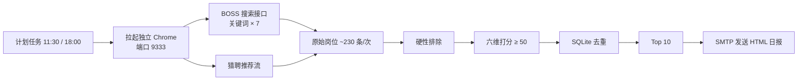

# 岗位雷达 · Job Match Radar

每天定时从 **BOSS 直聘** 与 **猎聘** 采集岗位，按自定义简历画像做**硬性排除 + 六维打分**，SQLite 去重后把 Top N 岗位渲染成 HTML 日报，通过 SMTP 发到邮箱。

> 面向「金融业务 + 数字化」这类复合背景的求职场景：先把不想要的岗位挡掉（保险公司主体、第三方财富、纯销售岗、小金融机构），再在剩下的岗位里按业务域相关度排序，避免「大厂通用岗」挤掉「真正对口岗」。

## 特性

- **双站采集**：BOSS 走站内 `joblist.json` 接口（薪资明文、字段完整）；猎聘走个性化推荐流（其关键词页有风控，推荐流更稳定）。
- **硬性排除**：销售岗、保险公司主体（科技子公司放行）、第三方财富/投资咨询、传统金融机构主体、薪资不达标。
- **六维打分**：岗位族 26 + 业务域 30 + AI/科技 14 + 层级 12 + 薪资 10 + 公司规模 8，阈值 50 分才推送。
- **跨次去重**：SQLite 记录已推送岗位，同一岗位 30 天内不重复出现；晚场只发当天新增。
- **HTML 日报**：表格化邮件，含匹配理由；采集到 0 条时改发「需要人工补登」告警。
- **可编排**：内置 `install_task.ps1` 一键注册 Windows 计划任务（默认 11:30 / 18:00）。
- **无凭据入库**：授权码只从 `.env` 读取，`.env`、登录态、简历、数据库均在 `.gitignore` 中。

## 工作流



## 快速开始

要求：Python 3.10+、本机已安装 Chrome。

```powershell
git clone https://github.com/jesse0713/job-match-radar.git
cd job-match-radar
python -m venv .venv
.\.venv\Scripts\Activate.ps1
pip install -r requirements.txt
copy .env.example .env
```

### 1. 首次登录（关键）

程序通过 CDP 附着到一个**独立配置**的 Chrome（端口 9333），不会干扰日常浏览器：

```powershell
python collect.py
```

弹出的浏览器窗口里分别登录 **BOSS 直聘** 和 **猎聘**（扫码即可）。登录态保存在 `chrome-profile/`，后续自动复用。该目录等同账号凭据，**不要提交、不要外发**。

### 2. 填授权码

在 `.env` 中填入邮箱 SMTP 授权码（QQ 邮箱：设置 → 账户 → 开启 SMTP → 生成授权码）：

```ini
QQ_SMTP_AUTH=你的授权码
MAIL_FROM=you@qq.com
MAIL_TO=you@qq.com
```

### 3. 试跑

```powershell
python run_daily.py --demo --dry-run          # 假数据验证打分与渲染链路
python run_daily.py --slot 11:30 --dry-run    # 真实采集，只写 .eml 预览不发信
python run_daily.py --slot 11:30              # 真实采集并发送
```

`outbox/` 下会生成 `.eml` 和 `preview.html`，可直接用邮件客户端打开检查版式。

### 4. 定时运行

```powershell
powershell -ExecutionPolicy Bypass -File .\install_task.ps1
```

脚本会读取 `config.json` 的 `search.run_times` 注册计划任务（`JobMatch-1130`、`JobMatch-1800`），并自动探测 Python。
删除：`Unregister-ScheduledTask -TaskName "JobMatch-1130" -Confirm:$false`。

## 配置

调策略只改 `config.json`，不用动代码。

| 键 | 说明 |
|---|---|
| `mail.*` | SMTP 服务器与收发件地址；真实地址建议放在 `.env` 的 `MAIL_FROM` / `MAIL_TO` |
| `search.daily_count` | 每次最多推送条数（默认 10） |
| `search.min_salary_k` | 月薪下限（K），薪资上限低于该值直接排除 |
| `search.run_times` | 计划任务的运行时刻 |
| `keywords.core` / `.extra` | 搜索关键词；`extra` 每天轮换一个，扩大覆盖面 |
| `candidate_profile.summary` | 邮件里「匹配依据」的一句话说明 |
| `role_families` | 岗位族与权重（解决方案 / FDE / 产品 / 数字化 / 交付） |
| `domain_terms` | 业务域词表，分高/中/低三档给分 |
| `ai_tech_terms` | AI / 科技属性词表 |
| `seniority` | 职级词表（总监 / 专家 / 经理 / 初级） |
| `exclude.*` | 排除规则：销售岗、财富管理主体、保险主体、科技子公司白名单、规模门槛 |
| `company_scale_hint` | 常见公司规模提示，用于补全接口未返回的规模字段 |
| `scoring.*` | 六维满分与推送阈值 |

## 打分机制

硬性排除命中即 0 分，不进入排序：

1. 岗位名含销售类关键词（售前 / 解决方案 / 架构 / 产品 / 咨询 例外）
2. 公司为保险公司主体且不含科技子公司特征
3. 公司为第三方财富管理 / 投资咨询
4. 公司为传统金融机构主体（银行 / 券商 / 保险 / 信托等，科技子公司放行）
5. 薪资上限低于 `min_salary_k`

通过后按六维累加：

| 维度 | 满分 | 逻辑 |
|---|---|---|
| 业务域 | 30 | 高权重词 +6、中 +4、低 +2；标题命中高权重词再 +4 |
| 岗位族 | 26 | 5 个岗位族按权重取最高命中 |
| AI / 科技 | 14 | 命中词数 × 4，封顶 14 |
| 层级 | 12 | 总监级 12、专家级 10、默认 6、初级 1 |
| 薪资 | 10 | 达下限满分；未标注 5 分；明显偏低降权 |
| 公司规模 | 8 | 规模档位 / 5 折算，接口缺失时用公司名提示补全 |

业务域得分 < 6 的「纯技术岗」整体 ×0.75 降权。排序：`匹配分 → 公司规模 → 发布时间`。

## 目录结构

```
.
├── config.json          # 策略配置（关键词、排除规则、权重、阈值）
├── match_engine.py      # 硬性排除 + 六维打分 + 排序
├── collect.py           # 浏览器采集（BOSS 接口 + 猎聘推荐流）
├── store.py             # SQLite 去重库
├── mailer.py            # SMTP 发信 + HTML 日报模板
├── run_daily.py         # 编排入口（--slot / --dry-run / --demo）
├── preview_email.py     # 生成邮件预览页并截图
├── read_resume.py       # 把 .docx 简历抽成纯文本，便于摘录关键词
├── tune_domain.py       # 调整业务域词表的小工具
├── install_task.ps1     # 注册 Windows 计划任务
├── requirements.txt
└── .env.example         # 环境变量模板（复制为 .env）
```

运行时生成、均被忽略：`jobs.db`、`logs/`、`outbox/`、`chrome-profile/`。

## 环境变量

| 变量 | 必填 | 说明 |
|---|---|---|
| `QQ_SMTP_AUTH` | 是 | 邮箱 SMTP 授权码；缺失时自动 dry-run |
| `MAIL_FROM` / `MAIL_TO` | 否 | 覆盖 `config.json` 的收发件地址 |
| `CHROME_PATH` | 否 | 指定 Chrome 可执行文件 |
| `CHROME_PROFILE_DIR` | 否 | 登录态目录，默认 `./chrome-profile` |
| `CHROME_DEBUG_PORT` | 否 | 调试端口，默认 `9333` |
| `JOB_DB_PATH` | 否 | 去重库路径，默认 `./jobs.db` |

## 已知限制

- **登录态会失效**：失效时采集为 0 条，会发告警邮件；重新打开自动化浏览器扫码即可。
- **猎聘关键词页被风控**：已改用个性化推荐流，结果与账号的求职期望相关。
- **无发布时间字段**：两个平台的列表接口都不返回发布时间，用「每日新增去重」近似替代。
- **单次约 3–4 分钟**：7 个关键词 × 1 页 + 推荐流滚动。
- 页面结构或接口一旦改版，`collect.py` 的选择器需要同步调整。

## 隐私与安全

- 仓库内**不含**任何真实简历、手机号、邮箱地址、SMTP 授权码或采集数据；示例值均为占位符。
- `.env`、`jobs.db`、`logs/`、`outbox/`、`chrome-profile/` 已在 `.gitignore` 中排除，请勿手动 `git add -f`。
- 邮件模板对岗位标题、公司名、链接做了 HTML 转义，并只允许 `http(s)` 链接，避免第三方数据注入标签。
- 授权码一旦泄露，请立刻在邮箱后台「重置授权码」。
- 采集依赖个人登录态。请遵守各平台服务条款，仅用于个人求职，不要高频请求或转售数据。

## License

[MIT](LICENSE)
